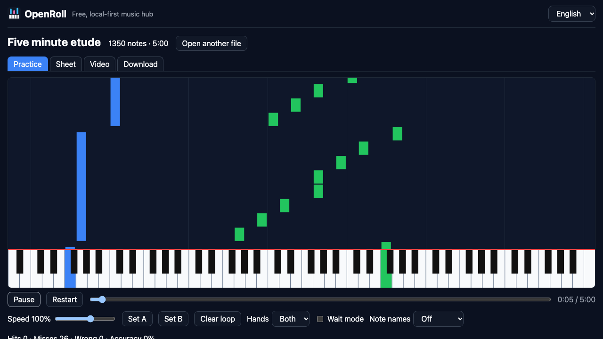
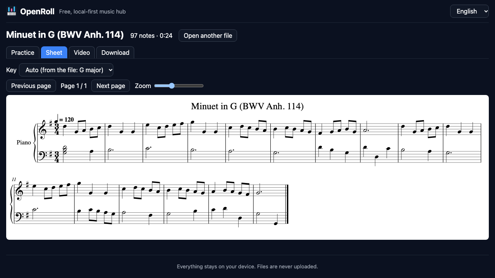
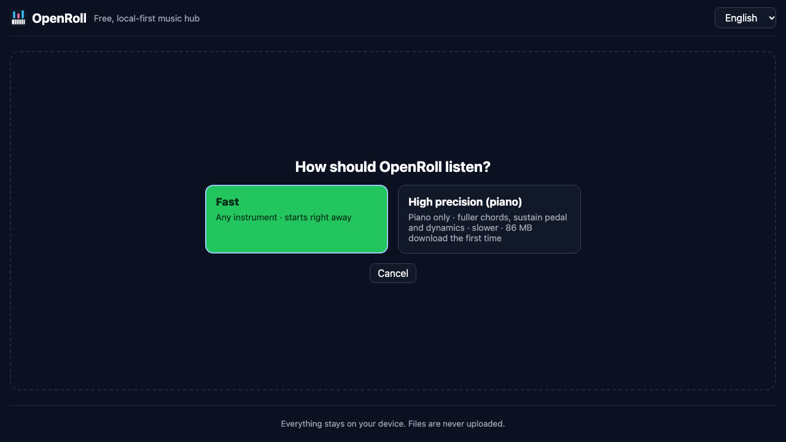
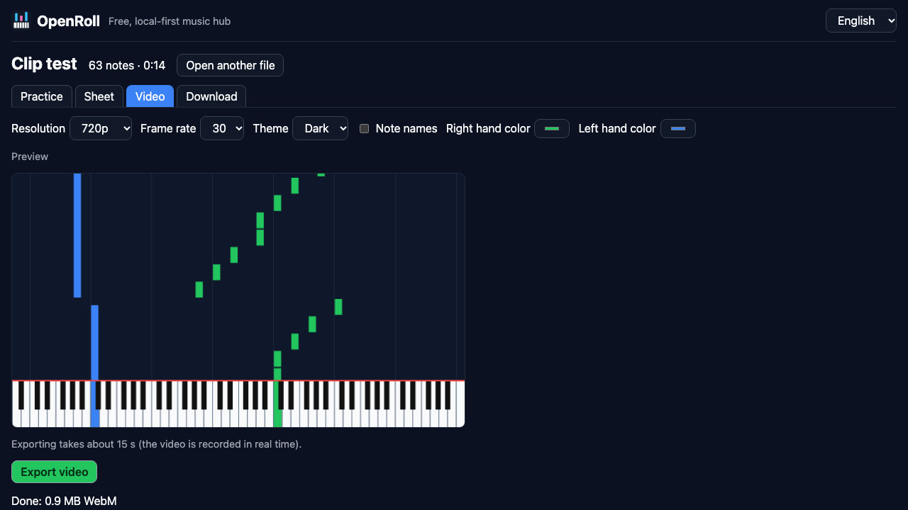
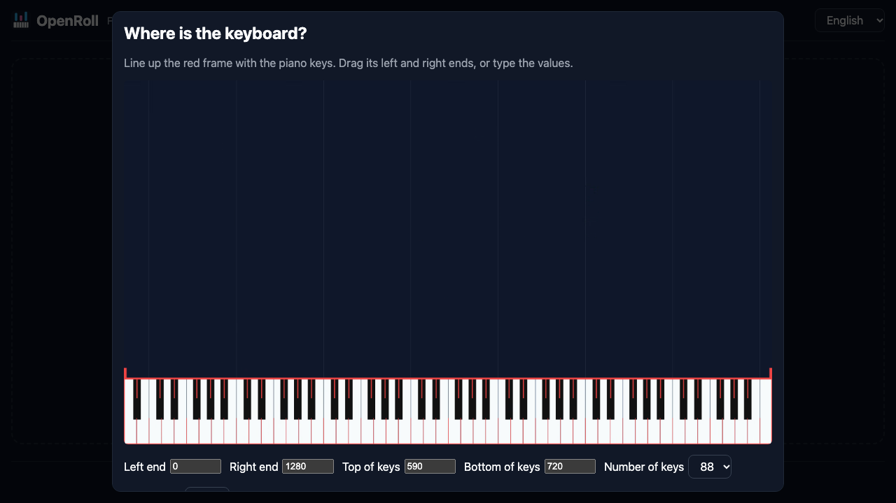
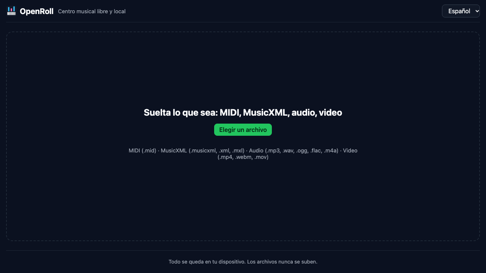

# OpenRoll

*[Read in English](README.md)*

Centro musical libre, de código abierto y local. Suelta un archivo MIDI, un MusicXML, una grabación de audio, un video de alguien tocando o un video de notas que caen, y OpenRoll lo convierte en:

- una **vista de práctica** con notas que caen, entrada por teclado MIDI (o el teclado del computador), modo espera, puntaje y repetición de una sección,
- **partitura** (piano a dos pentagramas, renderizada con Verovio) con tempo, compás, tonalidad y nota más corta editables,
- un **video de notas que caen** exportado (WebM, con sonido de piano),
- descargas **MIDI / MusicXML**.

Todo corre en tu navegador. Sin servidor, sin cuentas, sin claves de API, sin rastreo. Tus archivos nunca salen de tu dispositivo, y la app funciona sin conexión una vez cargada (es una PWA instalable).



| Partitura | Dos formas de escuchar una grabación |
|---|---|
|  |  |

| Exportar video de notas que caen | Calibración del teclado en videos de notas que caen |
|---|---|
|  |  |

Las capturas están en inglés; la app también está en español (selector de idioma arriba a la derecha).



## Cómo se usa

1. Abre la app y suelta un archivo en la página (o haz clic en **Elegir un archivo**). ¿No tienes uno a mano? Haz clic en **prueba con una pieza de ejemplo**.
2. Con audio y videos de interpretación, elige cómo quieres que OpenRoll escuche:
   - **Rápido**: cualquier instrumento, empieza enseguida.
   - **Alta precisión (piano)**: solo piano; oye acordes más completos, el pedal y la dinámica; más lento. Su modelo (~86 MB) se descarga del mismo servidor de la app la primera vez que lo eliges y queda guardado para usarlo sin conexión.
3. Con un video, di si es un **video de notas que caen** o una **interpretación real**. Los videos de notas que caen se leen cuadro a cuadro; si el teclado no se encuentra con seguridad, se abre un diálogo de calibración para alinear un marco con las teclas del piano.
4. Usa las pestañas:
   - **Práctica**: toca con un teclado MIDI (Chrome/Edge/Firefox) o con el teclado del computador (`A W S E D F T G Y H U J K`; `Z`/`X` cambian de octava). La barra espaciadora reproduce y pausa. **Repetir: inicio / fin** repite una sección. El **modo espera** se detiene hasta que toques la nota correcta.
   - **Partitura**: tempo (o márcalo con toques), compás, tonalidad (detectada sola o elegida), nota más corta y **Simplificar** para que las grabaciones salgan legibles.
   - **Video**: exporta un video de notas que caen (720p/1080p, 30/60 cuadros por segundo, tema oscuro/claro, nombres de notas).
   - **Descargar**: archivos MIDI y MusicXML.

## Formatos soportados

| Entrada | Extensiones |
|---|---|
| MIDI | .mid, .midi |
| MusicXML | .musicxml, .xml, .mxl |
| Audio | .mp3, .wav, .ogg, .flac, .m4a |
| Video de interpretación | .mp4, .webm, .mov (se transcribe el audio) |
| Video de notas que caen | .mp4, .webm, .mov (se calibra el teclado y se lee cuadro a cuadro) |

Navegadores: Chrome, Edge y Firefox de escritorio. Safari funciona sin entrada de teclado MIDI (no tiene Web MIDI).

## Correrlo tú mismo

Necesita Node.js 22 o posterior.

```bash
npm ci                               # también copia el modelo de Basic Pitch y descarga el de Transkun
npx playwright install chromium      # una vez, para las pruebas e2e
npm run dev                          # servidor de desarrollo
npm run build                        # build estático en dist/; sírvelo con cualquier servidor web estático
```

`npm ci` descarga una sola vez el modelo de alta precisión (~57 MB, verificado con SHA-256) en `public/models/transkun/`. Con `TRANSKUN_SKIP=1` se omite, y la app ofrece solo el modo rápido para grabaciones. La app en ejecución nunca se conecta a otro servidor distinto del que la sirve.

## Desarrollo

```bash
npm run check      # tipos + lint + tests unitarios/round-trip + auditoría de licencias (debe pasar antes de cada commit)
npm run test:e2e   # Playwright (Chromium)
TRANSKUN=1 npx vitest run tests/roundtrip/transkun.test.ts   # opcional: modo alta precisión con el modelo real
```

Cada conversor tiene una prueba de ida y vuelta que imprime su precisión (F1 de notas con tolerancia de ataque). Las decisiones de diseño, con las alternativas consideradas, están en [docs/DECISIONS.md](docs/DECISIONS.md).

### Arquitectura

Toda entrada se convierte en un único `Score` canónico (`src/core/score.ts`); toda salida lee de `Score`. N entradas más M salidas, nunca N×M conversores. Los conversores se registran en `src/converters/registry.ts`. El trabajo pesado (inferencia de modelos, análisis de cuadros de video, render de partituras) corre en Web Workers para que la página nunca se congele.

```
entradas: midi · musicxml · audio · video de interpretación · video de notas que caen
                                ↓
                              Score
                                ↓
salidas:  práctica · partitura · exportar video · archivo MIDI · archivo MusicXML
```

## Licencia

OpenRoll tiene licencia [GNU AGPL-3.0-only](LICENSE).

## Créditos

OpenRoll se apoya en estos proyectos (lista completa con licencias en [CREDITS.md](CREDITS.md)):

- [Basic Pitch](https://github.com/spotify/basic-pitch-ts) de Spotify (Apache-2.0): modelo rápido de audio a notas.
- [Transkun](https://github.com/Yujia-Yan/Transkun) de Yujia Yan, Frank Cwitkowitz y Zhiyao Duan (MIT): transcripción de piano de alta precisión, ejecutada con [ONNX Runtime Web](https://github.com/microsoft/onnxruntime) (MIT).
- [Verovio](https://www.verovio.org) (LGPL-3.0, cargado sin modificar como módulo aparte): render de partituras.
- [Tone.js](https://github.com/Tonejs/Tone.js) y [@tonejs/midi](https://github.com/Tonejs/Midi) (MIT): reproducción de audio y archivos MIDI.
- Muestras [Salamander Grand Piano](https://archive.org/details/SalamanderGrandPianoV3) de Alexander Holm (CC-BY 3.0).
- [TensorFlow.js](https://github.com/tensorflow/tfjs) (Apache-2.0) y [React](https://react.dev) (MIT).
