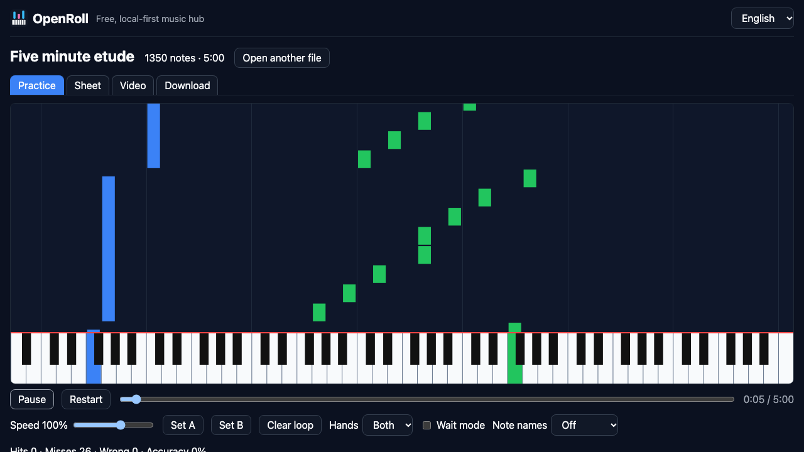
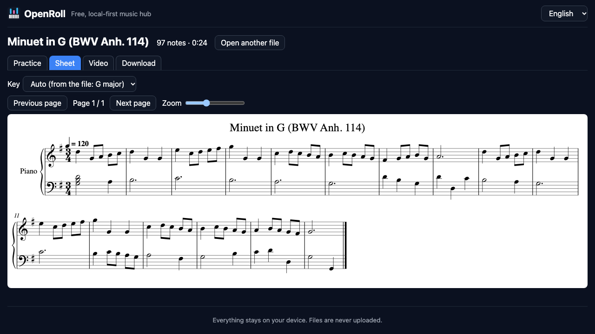
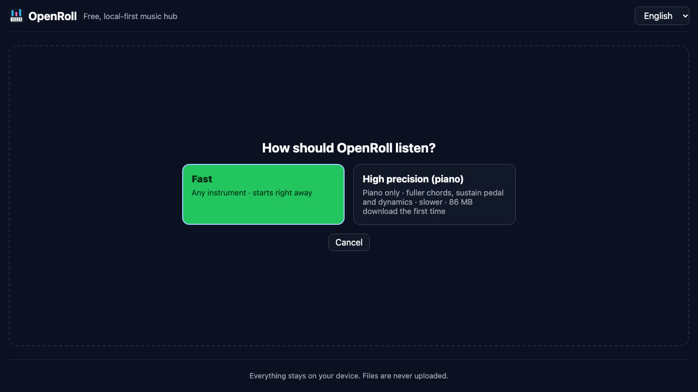
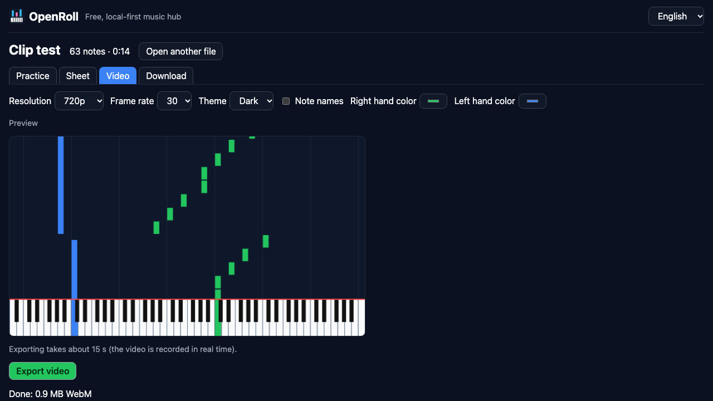
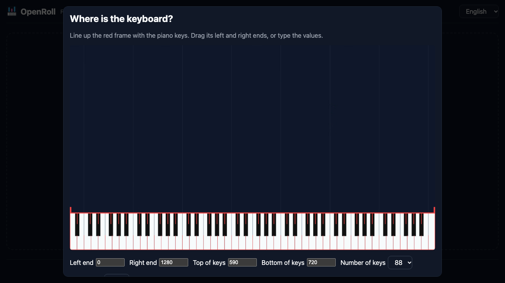

# OpenRoll

*[Leer en español](README.es.md)*

Free, open-source, local-first music hub. Drop a MIDI file, MusicXML, an audio recording, a video of someone playing, or a falling-notes video, and OpenRoll turns it into:

- a **practice view** with falling notes, MIDI-keyboard (or computer-keyboard) input, wait mode, scoring and a repeat section,
- **sheet music** (two-staff piano, rendered with Verovio) with editable tempo, meter, key and note grid,
- an exported **falling-notes video** (WebM, with piano sound),
- **MIDI / MusicXML** downloads.

Everything runs in your browser. No backend, no accounts, no API keys, no tracking. Your files never leave your device, and the app works offline once loaded (it's an installable PWA).



| Sheet music | Two ways to listen to a recording |
|---|---|
|  |  |

| Falling-notes video export | Keyboard calibration for falling-notes videos |
|---|---|
|  |  |

## How to use it

1. Open the app and drop a file on the page (or click **Choose a file**). No file at hand? Click **try an example piece**.
2. For audio and performance videos, pick how OpenRoll should listen:
   - **Fast**: any instrument, starts right away.
   - **High precision (piano)**: piano only, hears fuller chords, the sustain pedal and dynamics, slower. Its model (~86 MB) is downloaded from the app's own server the first time you pick it, then kept for offline use.
3. For a video, say whether it is a **falling-notes video** or a **real performance**. Falling-notes videos are read frame by frame; if the keyboard isn't found with confidence, a calibration dialog opens so you can line a frame up with the piano keys.
4. Use the tabs:
   - **Practice**: play along with a MIDI keyboard (Chrome/Edge/Firefox) or your computer keyboard (`A W S E D F T G Y H U J K`, `Z`/`X` change octave). Space plays/pauses. **Repeat: start / end** loops a section. **Wait mode** stops until you play the right note.
   - **Sheet**: tempo (or tap it), time signature, key (auto-detected or chosen), shortest note and **Simplify** for readable notation from recordings.
   - **Video**: export a falling-notes video (720p/1080p, 30/60 fps, dark/light theme, note names).
   - **Download**: MIDI and MusicXML files.

## Supported formats

| Input | Extensions |
|---|---|
| MIDI | .mid, .midi |
| MusicXML | .musicxml, .xml, .mxl |
| Audio | .mp3, .wav, .ogg, .flac, .m4a |
| Performance video | .mp4, .webm, .mov (the audio track is transcribed) |
| Falling-notes video | .mp4, .webm, .mov (the keyboard is calibrated and read frame by frame) |

Browsers: Chrome, Edge and Firefox on desktop. Safari works without MIDI-keyboard input (it has no Web MIDI).

## Running it yourself

Requires Node.js 22 or later.

```bash
npm ci                               # also copies the Basic Pitch model and downloads the Transkun model
npx playwright install chromium      # once, for e2e tests
npm run dev                          # dev server
npm run build                        # static build in dist/ — host it on any static web server
```

`npm ci` downloads the high-precision model (~57 MB, SHA-256 checked) into `public/models/transkun/` once. Set `TRANSKUN_SKIP=1` to skip it; the app then offers only the fast mode for recordings. The running app never contacts any server other than the one serving it.

## Development

```bash
npm run check      # typecheck + lint + unit/round-trip tests + license audit (must pass before every commit)
npm run test:e2e   # Playwright (Chromium)
TRANSKUN=1 npx vitest run tests/roundtrip/transkun.test.ts   # optional: high-precision mode with the real model
```

Every converter has a round-trip test that prints its accuracy (note F1 with onset tolerance). Design decisions, with the alternatives considered, are logged in [docs/DECISIONS.md](docs/DECISIONS.md).

### Architecture

Every input converts to one canonical `Score` (`src/core/score.ts`); every output reads from `Score`. N inputs plus M outputs, never N×M converters. Converters register in `src/converters/registry.ts`. Heavy work (ML inference, video frame analysis, notation rendering) runs in Web Workers so the page never freezes.

```
inputs:  midi · musicxml · audio · performance video · falling-notes video
                               ↓
                             Score
                               ↓
outputs: practice · sheet music · video export · MIDI file · MusicXML file
```

## License

OpenRoll is licensed under the [GNU AGPL-3.0-only](LICENSE).

## Credits

OpenRoll stands on these projects (full list with licenses in [CREDITS.md](CREDITS.md)):

- [Basic Pitch](https://github.com/spotify/basic-pitch-ts) by Spotify (Apache-2.0): fast audio-to-notes model.
- [Transkun](https://github.com/Yujia-Yan/Transkun) by Yujia Yan, Frank Cwitkowitz and Zhiyao Duan (MIT): high-precision piano transcription, run with [ONNX Runtime Web](https://github.com/microsoft/onnxruntime) (MIT).
- [Verovio](https://www.verovio.org) (LGPL-3.0, loaded unmodified as a separate module): sheet-music rendering.
- [Tone.js](https://github.com/Tonejs/Tone.js) and [@tonejs/midi](https://github.com/Tonejs/Midi) (MIT): audio playback and MIDI files.
- [Salamander Grand Piano](https://archive.org/details/SalamanderGrandPianoV3) samples by Alexander Holm (CC-BY 3.0).
- [TensorFlow.js](https://github.com/tensorflow/tfjs) (Apache-2.0) and [React](https://react.dev) (MIT).
